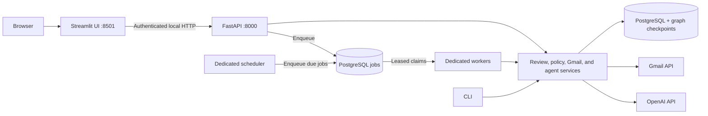

# Application architecture

Milestones 3b and 3c are implemented: a durable PostgreSQL job queue and dedicated services ([startup/recovery runbook](JOBS.md)) now accompany the API/UI boundary. The running app uses PostgreSQL through a SQLAlchemy connection boundary with Alembic migrations; SQLite remains a developer/test backend. See [the database runbook](DATABASE.md) for local server startup, importing old data, backups, and rollback limits. The API/UI boundary described below is preserved.

The dashboard is now an HTTP client. It does not open the review database, instantiate Gmail clients, run model agents, or spawn workers. FastAPI validates and enqueues slow operations; workers execute them through the existing domain code. Manual review and Gmail actions remain synchronous. CLI commands and the dedicated scheduler continue using the domain layer directly.



## Start locally

In the project directory, start the API in one PowerShell terminal:

```powershell
.\.venv\Scripts\python.exe -m triage.api
```

Start dedicated workers and the scheduler using [the service runbook](JOBS.md). Start the dashboard in another terminal:

```powershell
.\.venv\Scripts\python.exe -m streamlit run dashboard.py
```

Open `http://127.0.0.1:8501`. API health is at `http://127.0.0.1:8000/health`, and interactive endpoint documentation is at `http://127.0.0.1:8000/docs`. The schema/health pages contain no mailbox records. Data and mutation endpoints require a bearer credential. API startup creates `.secrets/api_token`; the server-side dashboard adapter reads it automatically. This token is separate from the OpenAI key and Google OAuth tokens. Never paste it into chat, expose it to a browser component, or commit it. No new external credentials are needed.

The dashboard's default API origin is `http://127.0.0.1:8000`. A shell environment variable `TRIAGE_API_URL` can change it to another local origin. Container/hosted deployment may explicitly trust one exact private origin with `TRIAGE_INTERNAL_API_ORIGIN`; other remote origins, embedded credentials, and redirects are rejected. The UI does not load the server's `.env`; the API/CLI/worker continue loading settings and configured secret-file mounts. Expose only the authenticated HTTPS gateway in a deployment.

## API surface

All application endpoints are under `/v1`:

| Operation | Endpoints |
|---|---|
| Review queue | `GET /summary`, `GET /emails`, `GET /emails/{id}` |
| Decisions | `POST /emails/{id}/review` |
| Gmail actions | `POST /emails/{id}/label`, `/label/undo`, `/read-state` |
| Original / replies | `GET /emails/{id}/original`, `POST /emails/{id}/reply/draft`, `/reply/prepare`, `/reply/send` |
| Ingestion | `POST /ingestions` (202 job receipt) |
| Job control | `GET /jobs`, `GET /jobs/{id}`, `POST /jobs/{id}/cancel`, `/retry`, `GET /services` |
| Scheduler | `GET /automation`, `PUT /automation`, `POST /automation/start`, `/automation/stop` |
| Digests | `GET /accounts`, `GET /digests`, `POST /digests/generate`, `POST /digests/{id}/clear-attempt` |
| Evidence | `GET /audit`, `GET /evaluations` |

Request models reject extra fields and constrain labels, tones, batch limits, instructions, and action parameters. Core queue/summary/detail responses have explicit models. Query filtering, sorting, counts, and pagination run at the API/database boundary; the UI no longer downloads the full queue to paginate it. The detail endpoint returns stored proposals and current policy decisions without fetching Gmail bodies. Original-message loads and AI drafts remain explicit operations.

## Execution and approvals

The API reuses the existing review, account-match, proposal-policy, label idempotency, and send-state checks. A caller cannot send by supplying a recipient or arbitrary raw message. It must prepare a reply bound to a stored Gmail item, inspect that payload, and submit its exact generated message ID plus boolean `confirmed: true`. Missing/false/numeric confirmation, stale versions, sample records, mismatched accounts, and repeat sends are rejected. Automatic replies remain unsupported. Local API authorization identifies one trusted owner; it is not multi-user authorization.

Side-effecting HTTP calls are not automatically retried by the dashboard. If a send request times out, refresh its stored state and inspect Gmail Sent before doing anything else. A response lost after Gmail accepted a send still requires the existing uncertain-state recovery procedure. Label/read-state operations preserve their original semantics.

Manual ingestion, AI drafting, and digest generation commit durable jobs and return 202. Dedicated workers persist progress/results and recover expired leases; the dashboard polls without tying processing to a browser connection. See [queue delivery semantics](JOBS.md) for retries, cancellation, idempotency, and billing limits.

## Local security and observability

- Both services bind loopback by default. A trusted-host allowlist and no cross-origin permissions reduce unintended browser access to the API.
- All `/v1` routes require the locally generated service bearer credential. It is compared in constant time and never returned in a response.
- Every request receives an `X-Request-ID`. Audit events performed during API requests include the same ID for correlation. Request bodies, Google tokens, and the OpenAI key are not logged by the API. Uvicorn access logging is disabled by the bundled launcher.
- Validation/provider errors are sanitized; private draft bodies/provider response text are not reflected in error messages. Domain conflicts return `409`, invalid fields `422`, unknown records `404`, authentication errors `401`, and provider failures `502`.
- Opening the UI, schema, or health page does not fetch Gmail, classify emails, send replies, or start a scheduled worker.

This stage uses a single local owner and shared service credentials. PostgreSQL, migrations, durable jobs, worker leases, and a dedicated scheduler are implemented. Deployment packaging, a single-owner login gateway, backups, health checks, and per-attempt operational evidence are now prepared; see [deployment instructions](DEPLOYMENT.md). Local Docker build and deployment smoke checks have passed; actual hosted activation remains pending. Per-user login/OAuth/data isolation, retention, and hosted activation remain future work.

## Verification

```powershell
.\.venv\Scripts\python.exe -m unittest discover -s tests -v
```

Dashboard tests now use FastAPI's in-process test transport and temporary databases, so they exercise HTTP serialization and routing while preserving mocked providers. API-specific tests cover authorization/host checks, input redaction, pagination/literal search, account isolation checks, request-to-audit correlation, approval/apply/undo, exact reply confirmation, partial ingestion failures, worker opt-in, and the UI dependency boundary. Live smoke checks should use only health, local summary, and saved report endpoints unless the user explicitly requests live email actions.
