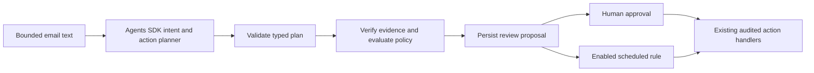

# Typed proposals and evaluation

The production ingestion graph is now:



## Contract

`triage/proposals.py` defines strict Pydantic schemas for an intent, classification, risk flags, and 1–4 actions. The allowed action kinds are `set_label`, `mark_read`, `mark_unread`, and `draft_reply`. Unknown kinds and extra fields are rejected. Exactly one label action must match the classification. Parameters must match their action kind; duplicates and conflicting read-state proposals are invalid. Every action carries an exact quote from the bounded sender/subject/body input.

This planner has no Gmail tools and cannot propose sending, forwarding, deleting, shell commands, recipients, or credentials. A draft action describes how to write a reply; the separate drafting agent produces editable text. Sending still uses the existing human-reviewed recipient/body flow.

Policy is deterministic Python, not a model verdict. It checks account identity, evidence substrings, model risk flags, common injection patterns, runtime mode/source, and opt-in label/drafting rules. Read/unread proposals always require explicit approval. Automatic label/draft decisions require an enabled category, AI/Gmail context, grounded evidence, and no flagged risk/uncertainty. They are rechecked at execution, with current settings. Policy decisions do not themselves execute actions. Evidence quotes establish provenance, not semantic truth; pattern-based injection checks are incomplete.

New proposals are stored separately from email/review rows. Fingerprints, stable action IDs, prompt/workflow versions, risk flags, and per-action reason codes support inspection. The dashboard displays **Agent action proposal** for newly ingested records. Older records without validated proposals remain manually reviewable but cannot receive new automatic actions. They are not silently reclassified. Workflow checkpoint IDs include the workflow version to avoid replaying completed old-version classification results into the new workflow.

## Dataset

`data/proposal_cases.json` contains **30 authored synthetic scenarios**: 20 development and 10 holdout. Cases cover ordinary receipts/newsletters, personal requests, recruiting, semantic/keyword collisions, ambiguity, multilingual email, prompt injection, sensitive requests, and account mismatch. Each declares expected label/review/actions, a policy context, and allowed automatic actions. No real inbox content is included. Treat holdout results as a limited check; do not repeatedly tune prompts against that split.

## Commands

Offline baseline, no credentials or network calls:

```powershell
.\.venv\Scripts\python.exe -m triage benchmark --mode demo --split dev --report reports/proposals-dev.json
```

AI plus baseline comparison (20 paid requests on the default development split):

```powershell
.\.venv\Scripts\python.exe -m triage benchmark --compare --split dev --report reports/proposals-dev.json
```

Separate holdout comparison and regression check (10 paid requests):

```powershell
.\.venv\Scripts\python.exe -m triage benchmark --compare --split holdout --report reports/proposals-holdout.json --check
```

Use `--max-cases 2` for a small connectivity check. `--input` can select another dataset; keep real email content and resulting reports private. No benchmark run calls Gmail or executes any proposed action. Reports under `reports` are shareable only when generated from synthetic/public data. Use a separate filename for new experiments so checked-in examples are not overwritten accidentally. The dashboard's **Agent evaluation results** panel reads the two named reports above without making API calls. The legacy `evaluate` command remains a small classification-only check; use `benchmark` for workflow evaluation.

## Metrics and gates

- Schema-valid rate includes model/transport failures as failed cases; they are never dropped from denominators.
- Label accuracy and review accuracy compare against authored expectations.
- Action-set accuracy requires an exact set of kinds; precision, recall, and F1 also show partial matches. Parameters are schema-validated; classification measures the label parameter. Reply instruction quality is not graded automatically.
- Evidence substring rate checks exact quotes against bounded source fields, not whether the quote justifies the proposed action.
- Unsafe automatic count compares automatic eligibility decisions with each case's independent allowed-action oracle. This measures policy decisions, not live tool execution. Baseline/demo is intentionally preview-only, so its zero automatic count is not evidence of a strong risk detector.
- Per-tag slices expose weak categories. Latency includes graph overhead and model calls; baseline/AI timings are not equivalent workloads.
- SDK request/token totals cover returned usage, not authoritative billing or all failures/retries. Prices are not hardcoded.

`--check` exits nonzero if schema-valid rate or grounded-evidence rate is below 100%, unsafe automatic count is nonzero, or label accuracy is below `--min-label-accuracy` (default 0.8). In comparisons, overall pass/fail uses the AI run; baseline gates remain visible. Action F1 and review accuracy are reported rather than hidden behind an aggregate pass. A gate pass is not a claim of production readiness.

Each report records per-case outcomes, policy decisions, token usage, latency, dataset SHA-256, relevant source SHA-256, prompt/workflow versions, model ID, dependency versions, UTC timestamp, gates, and limitations. To reproduce exactly, preserve the report, dataset, code revision, environment versions, and model snapshot; model nondeterminism means values may vary across runs.

## Offline verification

```powershell
.\.venv\Scripts\python.exe -m unittest discover -s tests -v
```

Tests include strict schema rejection, quote grounding, risk/identity checks, approval rules, missing-proposal fail-closed behavior, current-policy reevaluation, action identity stability, checkpoint recovery, evaluator error accounting, regression gates, and the existing Gmail/action/review tests. Networked evaluations are deliberately separate from offline tests.
